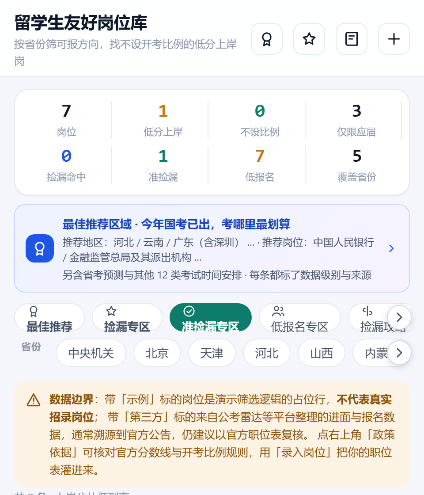
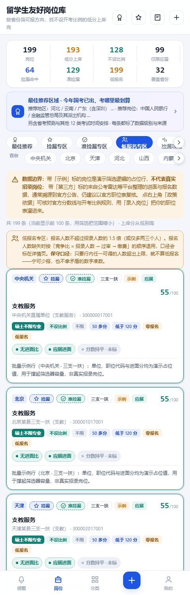
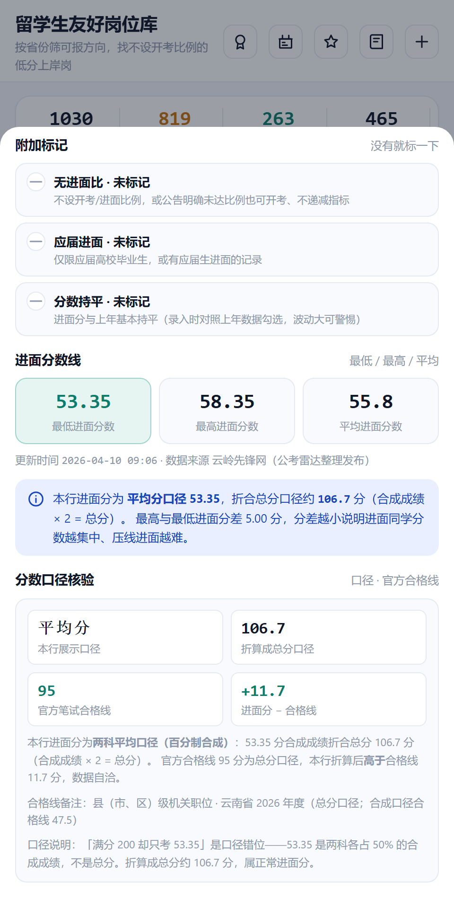
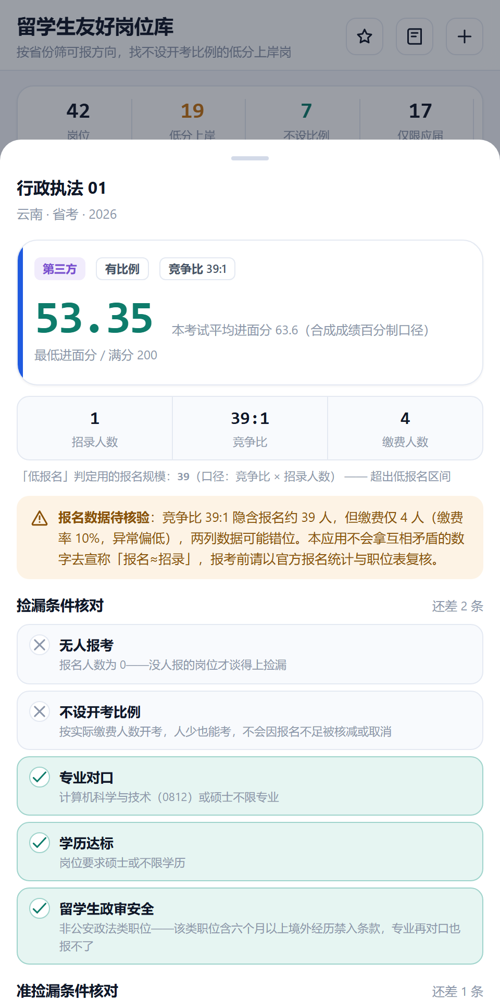
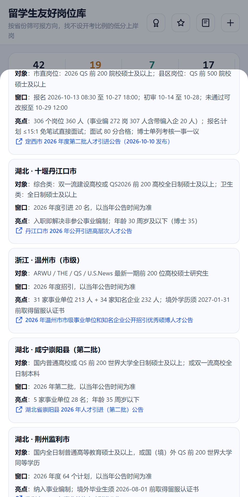
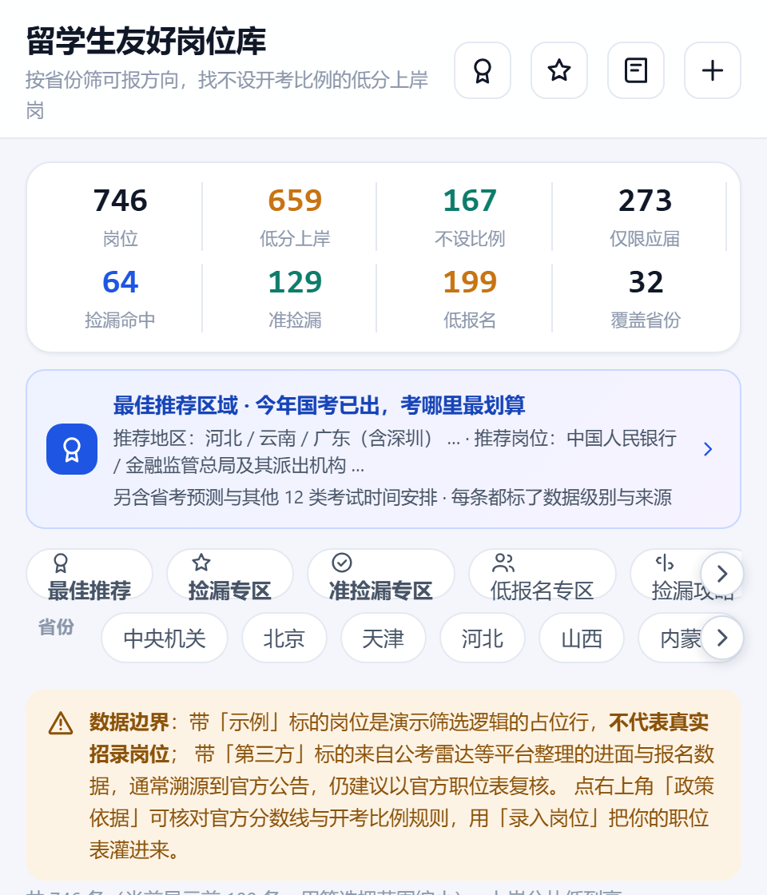
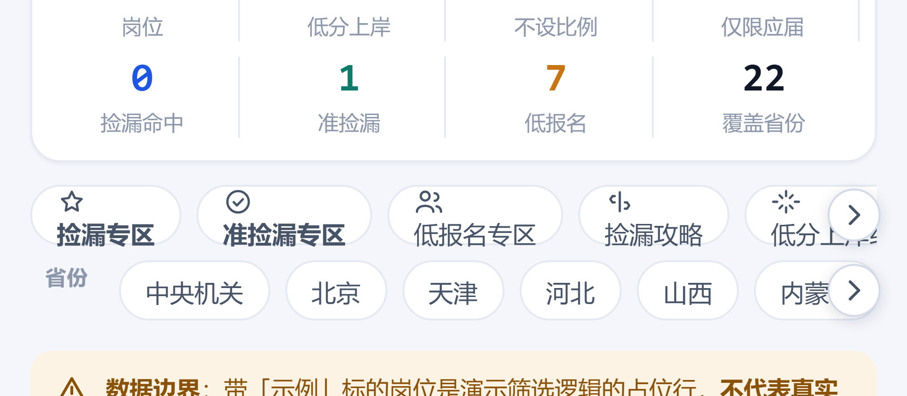
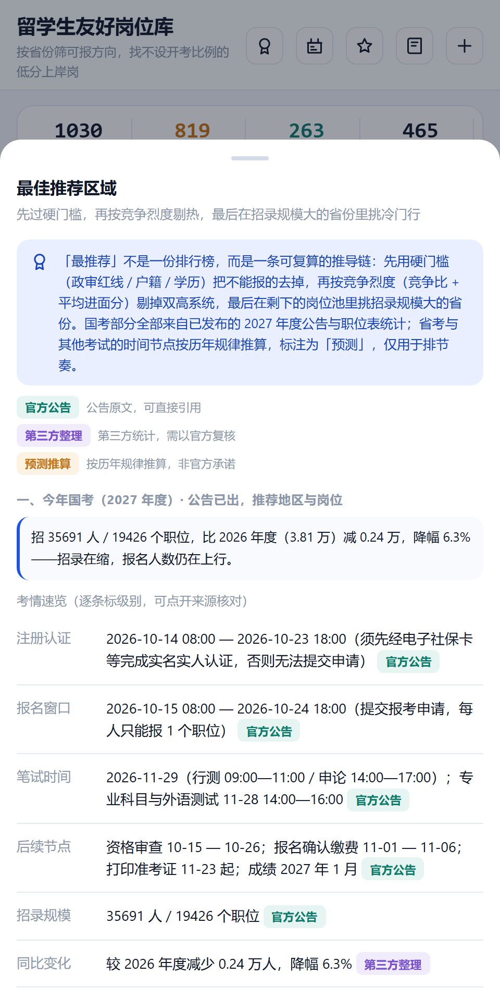
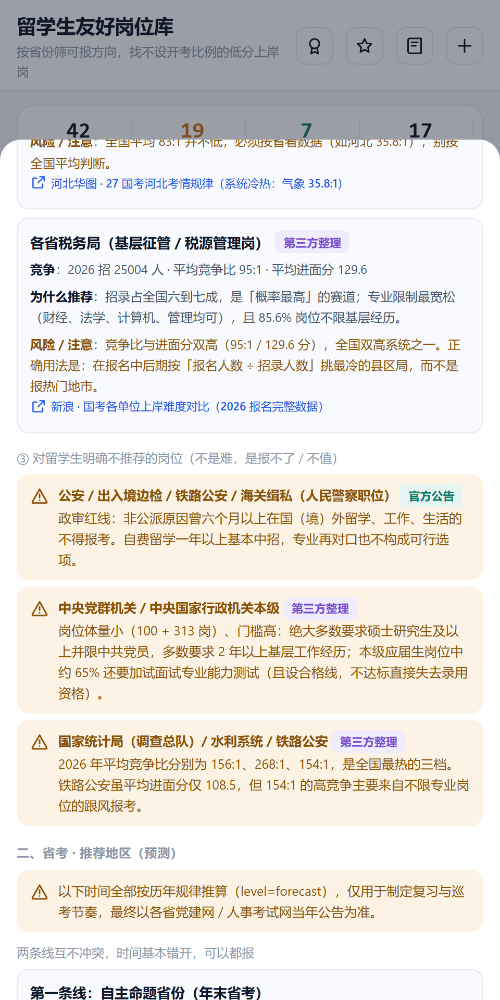

# 巡考日历 · 考编巡考生活

> 把散落在各省人事考试网、国家公务员局、军队人才网的招考节点，收进一个不刷屏、不遗漏的倒计时清单。
> 移动端优先的 Web App，**零外部运行时依赖**，`git clone` 后一条命令即可跑起来。

面向正在"考编巡考"的人：国考、省考、事业编、社区工作者、湖北选调、军队文职、三支一扶、人才引进、西部计划、留学生学历认证 —— 十条战线同时推进，最怕的是**报名截止日期悄悄错过**。

---

## 目录

- [界面预览](#界面预览)
- [功能一览](#功能一览)
- [快速开始](#快速开始)
- [工程记分卡](#工程记分卡)
- [技术设计](#技术设计)
- [接口一览](#接口一览)
- [配置项](#配置项)
- [CloudBase 云端部署](#cloudbase-云端部署)
- [测试与验收](#测试与验收)
- [目录结构](#目录结构)
- [已知边界](#已知边界)
- [许可](#许可)

---

## 界面预览

| 提醒首页 | 分类筛选 | 提醒详情 |
| :---: | :---: | :---: |
|  |  |  |

| 新增提醒 | 登录 | 我的 / 安全记录 |
| :---: | :---: | :---: |
|  |  |  |

| 岗位库列表 | 进面分数三件套 | 录入岗位（三件套 + 报名数据） |
| :---: | :---: | :---: |
|  |  |  |

| 捡漏专区（五条件圈选） | 捡漏攻略（窗口 / 政审 / 材料 / 实录） | 政法类职位 · 政审警告 |
| :---: | :---: | :---: |
|  |  |  |

| 准捡漏专区（命中 1 + 接近 6） | 低报名专区（公告级 + 规模推算） | 分数口径核验（53.35 → 总分 106.7 vs 合格线 95） |
| :---: | :---: | :---: |
|  |  |  |

| 报名数据一致性（矛盾数字标待核验） | 人才引进 · QS200 绿色通道 | 低门槛考试清单（三支一扶 / 社区 / 西部计划） |
| :---: | :---: | :---: |
|  |  |  |

| 提醒：十七类考试全覆盖 | 政策依据：云南省考合格线 | 岗位库统计条（8 项指标） |
| :---: | :---: | :---: |
|  |  |  |

| 类别详情页 · 人才引进（今年 + 明年预测 + 户籍未核实 + QS200 通道） | 类别详情页 · 消防救援（全国可报 + 招录规模） | 类别详情页 · 运营商（公告未核实 + 待核实说明） |
| :---: | :---: | :---: |
|  |  |  |

| 社区工作者 · 全国公告清单（156 条 / 31 省 / 省份筛选 chip + 折叠分组） |
| :---: |
|  |

| 筛选标签条：右边还有内容时浮出「›」 | 拖动后两端「‹ ›」同时出现，被裁掉的标签露出来 |
| :---: | :---: |
|  |  |

**最佳推荐区域**：入口横幅常驻筛选器上方，点开是三段可复算的推导链——今年国考考哪里、省考预测哪些地区、其他 12 类考试怎么排。

| 入口横幅（国考已出，一句话给结论） | 国考：考情速览 + 逐条标数据级别 | 省考：两条线 + 推荐地区（预测） | 其他考试：行动时间轴 + 窗口 |
| :---: | :---: | :---: | :---: |
|  |  |  |  |

> 全部界面使用统一的 24×24 SVG 线性图标，**刻意不使用任何 Emoji**，保证跨系统渲染一致、观感干净。

---

## 功能一览

### 1. 提醒首页
- 按**距离截止日由近及远**排序的倒计时卡片，一眼看到"最要紧的那个"。
- 每张卡片带考试类型标签 + 剩余天数；已过期、3 天内、7 天内分档着色，紧迫感分级。
- 顶部概览：进行中 / 7 天内 / 已过期 的数量统计。

### 2. 考试分类与筛选
- **十七**类别，可按**关键字 + 时间范围 + 归属（公共节点 / 我的）**组合筛选。
- 分类页显示每个类别的节点数量，以及"我创建的"数量（游客态下恒为 0，不会把公共节点误算成个人数据）。
- **点卡片进类别详情页**（`#/category/:key`）：不再在列表页原地多选过滤，而是每个类别都有一页说清「今年考情 / 明年预测 / 户籍口径 / 可考岗位」。

### 2b. 类别详情页（`#/category/:key`）
把散落在五个数据源里的东西，按"点一个类别"聚合到一页。**只做聚合视图，不生产新事实**——每一条都带着原有的数据级别徽标（`官方公告` / `第三方整理` / `预测推算`）和来源链接原样搬过来。

| 板块 | 内容 | 诚实边界 |
| --- | --- | --- |
| 今年考情 | 该类别当前年度的公告、时间节点、招录规模 | 每条沿用原级别（官方 / 第三方） |
| 明年预测 | 按历年规律推算的报名窗口与关键节点 | 一律标 `预测推算` 并写明"不是官方承诺" |
| 户籍口径 | 是否不限户籍 / 外地可考，附公告原文依据 | **没核到原文的类别显式渲染"未核实"卡片**，不静默省略 |
| 公告归档 | 该类别历年公告清单（只收能拿到原文链接的） | 日期从原文读出，原文只到月份就记到月份 |
| 可考岗位 | 岗位库中该类别在招岗位数与深链入口 | 点击深链跳到岗位库并自动带上 `examType` 过滤 |

- 17 个类别各自有配置（考试类型映射、归档分组、户籍口径、冷门统考映射），新增类别只需在 `server/catalog.mjs` 加定义 + 在 `server/category-detail.mjs#GUIDES` 补一份配置；**没核到公告的类别（运营商）只给「考什么 + 待核实说明」，不编今年动态**。
- 留服认证这类**不是考试**的类别不映射 `examType`、不渲染岗位深链——避免"看起来能报但实际查不到"。

### 2c. 岗位跳转链接 + 「考什么 · 备什么」

对标公考雷达的两件事：**每条岗位都能点出去**，**每类考试都知道考什么**。

**跳转链接（岗位卡底部一行，详情弹层同款按钮）**：
- 有 `sourceUrl` 的行（54 条第三方整理）→ **「公告 / 来源原文」**，直接跳公告或统计来源；
- 没有 `sourceUrl` 的行（示例行不伪造岗位页链接）→ 退到 **「该类考试官方入口」**（由岗位 `examType` 映射到分类官网：国考 → 中央机关报名专题、选调 → 省委组织部、烟草 → 国家烟草专卖局招聘平台……）；
- 映射规则：岗位 `xuandiao` ↔ 分类 `hubei-xuandiao`；运营商暂无对应分类，不注入兜底链接。

**考什么 · 备什么（三类场景都看得到）**：
- **分类卡片**：科目名串成一行概要（如国考卡"行政职业能力测验 + 申论 + 专业科目（部分职位）"）；
- **类别详情页**：完整板块——每科一句说明、面试形态、4 条准备清单（留服认证、应届身份、选岗口径、备考方法）；
- **岗位详情弹层**：按该行 `examType` 就地展示同款板块，不用跳出岗位库。

**数据诚实边界**：这是**常识级备考口径**（`server/catalog.mjs#EXAM_INFO`），不是官方公告——科目名称与流程按历年公告的普遍规律整理，界面逐处标注"以当年公告原文为准"；拿不准的数字（科目占比、通过率）一律不写。

### 2d. 社区工作者 · 全国公告清单

社区工作者没有全国统一考试，公告由省 / 市 / 区县 / 街道四级各自发文、全年滚动发布。原来的分类页只放了上海几条，完全看不出「到底还有多少地方在招」。

现在在社区工作者详情页里新增**全国公告清单**：
- **31 个省份**分组（按人数降序），每组可折叠；默认展开有数据的 24 省，7 省未取到可引用原文已诚实标注。
- **156 条公告**、清单内合计 **22,924 人**，每条带：地区、人数、报名窗口、笔试时间、户籍要求、**留学生口径**（国〈境〉外学历怎么处理）。
- **省份筛选 chip**：点「全部」「上海」「河南」「湖北」等快速过滤，只显示目标省份。
- **数据来源**：19 条官方原文（政府门户 / 人事考试中心）+ 137 条第三方整理（中公 / 华图 / 粉笔 / 易考吧 / 厚职 / 媒体转载），每条都带可点击的来源链接；人数与窗口读不到原文的整条标「见原文」，不猜。
- **覆盖度声明**：清单不是全国穷举，明确告诉用户「未取到 ≠ 当地没招」。

### 3. 提醒详情页
- 截止时间、所属类别、**公告原文直达链接**、个人备注。
- 支持编辑、删除、**一键克隆**（明年同一场考试直接复制，改个日期就行）。

### 4. 新增 / 编辑提醒
- 标题、类型、截止日期、公告链接、备注五项表单，前端实时校验 + 后端二次校验。
- 公告截图可直接粘贴/选择上传，前端先用 Canvas 压缩再传，避免大图打爆带宽。

### 5. 登录（两种方式并存）
- **数据库账号登录**：用户名 + 密码，服务端 `scrypt` 加盐哈希落库，全程无明文。
- **微信授权登录**：OAuth2 / OIDC 标准授权码流程（未配置 AppID 时自动降级为**明确标注的 Mock 通道**，便于本地联调）。

### 6. 我的 / 安全记录
- 登录设备列表（设备名、IP、最后活跃时间、当前设备标记），可**远程吊销任意设备**。
- 安全审计日志：登录、注册、改密、退出、越权尝试等全部留痕，可按动作与结果筛选。
- 支持"退出当前设备"与"退出全部设备"。

### 7. 管理后台（首个注册用户自动成为管理员）
- 用户列表、角色调整（guest / user / admin）、账号启停。
- 全量审计日志查询，精确到"谁在什么时候对谁做了什么"。

### 8. 留学生友好岗位库
面向留学生考公的选岗工具，回答六个问题：**哪些省我能报、哪些方向我能报、哪里分数低好上岸、哪里能捡漏、哪里能准捡漏、今年到底考哪里最划算**。

- **筛选维度**：32 个省级区域（31 省 + 中央机关）× 专业通道（计算机科学与技术 0812 / 硕士不限专业 / 两者皆可）× 开考比例（不设比例 / 有比例）× 应届要求 × 分数段（50 多分 / 低于 120 分）× 省份多选 × 关键词，一键套用「低分上岸组合」。
- **筛选标签条可拖动滑动**：筛选维度多到一行放不下（专业行 12 个标签约 1149px 宽、省份行 33 个约 2075px 宽，可视区只有 448px），原生滚动条被隐藏后桌面上既看不到还有内容、也用鼠标拖不动。现在**按住鼠标左右拖动即可滑动**（触屏保留原生惯性滑动），溢出时两端还会浮出圆形翻页按钮，点一下翻一屏——按钮本身同时也是「右边还有更多」的提示。该行为由 `public/js/ui.mjs#initChipRails` 统一用 `MutationObserver` 增强，岗位 / 分类 / 首页所有横向标签条自动生效，新增页面无需额外接入。
- **进面分数三件套 + 口径校准**：最低 / 最高 / 平均进面分数逐岗位呈现，卡片直接显示分数行；**每一行显式声明分数口径**（总分口径 = 行测 + 申论直接相加；两科平均口径 = 各占 50% 的百分制合成成绩），详情页自动折算成总分口径并与**官方合格线**比对，低于合格线标记「数据待核验」。「200 分只考 53.35」是口径误读——53.35 是合成成绩，折合总分约 106.7，高于云南省 2026 县级机关合格线 95。
- **报名数据 + 一致性自检**：竞争比、招录人数、报名人数、过审人数、缴费人数；几列数字互相矛盾时（如「竞争比 39:1」与「缴费 3 人」并存）会自动标出「报名数据待核验」并逐条说明问题。低报名判定用保守口径——任一可得的人数口径超出上限就不算低报名，另有公告级证据 `ratioShortfall`（公告明确未达开考比例被核减/取消）。
- **捡漏栏目**：把「没人报 + 我能报 + 考得起」拆成可核验的五条件——无人报考、不设开考比例、专业对口、学历达标、留学生政审安全，五条全中才「圈出来」（虚线徽标 + 卡片高亮）。
- **准捡漏栏目**：报名人数≈招录人数的岗位（≤1.5 倍，或仅多两三个人；公告明确未达开考比例的同样计入）——五条件为「报名≈招录 + 有进面分 + 专业可报 + 学历可报 + 政审安全」，另外三条**附加标记**（无进面比 / 应届进面 / 分数持平）命中亮起、缺失显示「未标记」，专治「没有就标记一下」。这类岗位集中在**三支一扶、社区工作者、西部计划**等不设开考比例或可开考的低门槛考试中，种子库含 6 条「未达开考比例被取消 / 核减」的真实实录（招 1 报 1、招 2 报 3 等）。
- **捡漏攻略弹层**：2027 国考实时报名窗口、每日盯数据方法、公安政法类职位对留学生的禁入条款、统考报名不需要简历的材料清单、2026 国考 89 个挂零职位的真实实录与「为什么捡不到」分析，以及新增的 **人才引进绿色通道**（QS 前 200 硕士不看本科层次的 5 个地区）、**低门槛考试清单**（三支一扶 / 社区工作者 / 西部计划 / 人才引进的开考比例口径）、**分数口径校准**（含云南省 2026 全部合格线档位）。
- **最佳推荐区域**：不排「排行榜」，给的是一条**可复算的推导链**——先用硬门槛（政审红线 / 户籍 / 学历）去掉不能报的，再按竞争烈度（竞争比 + 平均进面分）剔掉双高系统，最后在剩下的岗位池里挑招录规模大的省份。分三段：
  - **一、今年国考（2027 年度，公告已出）**：考情速览 16 条（招录 35691 人 / 19426 个职位、比 2026 年度减 6.3%、本科及以上占 76.0%、85.6% 岗位不限基层经历、行政执法类占 79.0%、计算机类 3609 个岗位…每条约带 `官方公告`/`第三方整理` 级别徽标）；**推荐 5 个地区**（河北：2026 平均竞争 71.6:1 低于全国 98:1，海事 25.5:1 / 气象 35.8:1 常年温和；云南：招 1925 人全国第 3 且边远倾斜；广东：岗位池全国最大 2969 人；山东：山东税务单家 1600 人；辽宁：计算机类岗位占全省 25.8% 居首）；**推荐 6 类岗位**（人民银行 54:1 / 金融监管 53:1 / 海事 47:1 / 审计署 42:1 / 气象 83:1（河北仅 35.8:1）/ 各省税务——每条写清「为什么推荐 + 风险 / 注意」，并附来源链接）；**明确不推荐 3 类**（公安边检类政审红线、中央机关本级门槛与专业测试、统计局 156:1 / 水利 268:1 / 铁路公安 154:1 三档最热）。
  - **二、省考（预测）**：两条线互不冲突可都报——自主命题省份（江苏 / 浙江 / 广东 / 山东 / 北京 / 上海 / 四川 / 天津，预计 2026-10 底至 11 月公告、12 月笔试）与多省联考（20 余省，预计 2027-01 中下旬公告、03 月中旬笔试）；推荐 3 类方向（四川：普通选调与省考同天共卷、门槛低且与国考错开 7 天；联考里的艰苦边远省份：县乡岗位多、合格线倾斜；江苏 / 浙江：计算机岗基数大、待遇高）；另列**省考特有约束**（留学生学历认证口径各省不同、户籍 / 生源限制、联考只能报一个省）。
  - **三、其他考试时间安排**：把一年压成一条行动时间轴（2026-10 至 2027-06，11 个节点），再逐条列 12 类考试的公告 / 报名 / 考试窗口——军队文职（先面试后笔试岗位已开放报名，统考预计 2026-12 中旬）、选调生（甘肃 / 安徽官方节点）、事业单位联考（上半年 5 月中下旬 / 下半年 9 月中下旬）、省内单招、三支一扶、西部计划、社区工作者、人才引进（QS 前 200 硕士绿色通道）、银行秋招与央国企校招。
- **数据诚实四级**：`官方公告` / `第三方整理`（公考雷达等平台，通常溯源到官方公告）/ `示例数据`（演示筛选逻辑的占位行）/ `我录入的`，每级在界面有明确 badge 与说明，示例行不代表真实岗位。**最佳推荐区域另用三档级别**标注：`官方公告`（可直接引用）/ `第三方整理`（统计口径，需以官方复核）/ `预测推算`（按历年规律推算，非官方承诺），测试会强制校验「级别必须在白名单内」且「带竞争 / 招录结论的条目必须有来源链接」。
- **历年公告归档**：岗位页顶栏与横幅双入口，点开是 **13 份往年公告原文**（更新至 2026-10-15），按国考 / 省考 / 事业单位 / 军队文职 / 三支一扶五类分组，每份给出「公告发布 → 网上报名 → 资格审查 → 缴费 → 打印准考证 → 笔试 → 成绩」的完整时间轴（共 68 行节点）、招录规模、逐年变化说明与原文外链。只收**已经发布过、且能拿到原文链接**的公告，日期一律从原文读出——原文只给到月份的（湖南、新疆兵团）就记到月份，不补造具体日；国考 2025 / 2026 / 2027 三个年度并列，可以直观看到「报名窗口几乎不动（都是 10-15 至 10-24）、笔试日期每年提前约 1 天」。归档不做任何预测，界面顶部写明收录范围有限、未逐省穷举。
- **外地可考 · 户籍口径**：岗位页标签条里的「外地可考」入口，点开按**户籍口径**而不是考试名气重排一遍我能考的考试。四档级别：`不限户籍`（国考、西部计划、河南万名乡村振兴村级协理员、湖北三支一扶）/ `应届不限·往届限本地`（社区工作者）/ `限本地` / `逐公告看`（县乡自招的村级后备干部）。**每条都附结论依据的公告原文与可点开的来源**，并且只写「哪个公告的口径」——三支一扶只写湖北省 2026 年度、社区工作者只写上海四个区 2026 年度，不把一个地方的结论外推到全国。没核到明确条款的（军队文职、选调生、人才引进等）一律不写进来，界面明确「没出现在这份清单里，既不等于限户籍，也不等于不限户籍」。**村官与西部计划同时新增为考试类型**，可以直接在筛选器里按类型筛。
- **冷门统考**：标签条里的「冷门统考」入口，收录「名字听过但从没去查过公告」的 5 类统一考试——**专利审查员全国统考**（电学/通信领域明确列计算机科学与技术、人工智能 080717T、智能科学与技术；事业编制、不限户籍、计算机/AI 硕士专业对口）、**中国烟草系统招聘**（公告逐字写明接受留学回国人员及留服认证时限）、**国家电网/南方电网一批二批统考**（数字化/信通计算机岗）、**农商行/农信社全省统考**（不足 1:3 会核减甚至取消岗位，是典型捡漏场景）、**国家综合性消防救援队伍消防员招录**（全国统考、可在户籍地或经常居住地省份报名）。**每条标明用工性质**——央企/国企校招多为合同制或劳务派遣，**不是行政/事业编制**。核不到当年度公告原文的（聘任制公务员、军队文职专业技能岗、辅警/网格员）单列在「待核实」区，不冒充已核实。
- **基层治理三板（留学生保底 / 过渡岗）**：在「村官」「社区工作者」「事业单位」三类详情页下挂三份可独立调用的全国招聘清单——**乡村振兴协理员**（cunban：河南 2026 省级专项 10,000 名全部纳入乡镇事业编制、明确不限户籍、国（境）外学历须完成留服认证；北京限北京生源、广西信息待核实，逐条标编制属性）、**网格员**（shequ：新疆 / 西藏 / 重庆 / 广东 4 地共 238 名，绝大多数为临聘无编、户籍只要求中华人民共和国国籍、国（境）外学历须留服认证，逐条标编制与户籍口径）、**武汉双盲考试**（shiye：武汉 2026 两场事业编招聘 3208 + 2945 均实行「双盲」面试——考生抽签定序、考官抽签定场、考生随机抽考官组，对没有本地关系的留学生最友好；双盲机制说明引自面试技术服务商公开战报，机制属实）。三份清单共用同一套「折叠分组 + 省份筛选 chip + 来源链接」渲染，每条带来源 URL 与级别徽标，测试强制校验「级别在白名单内 + 有来源必为 http(s)」。
- **政策依据页**：留学回国人员应届身份认定（国考口径）、2026 年度国考三档笔试合格线（90 / 95 / 105）、云南省考 2026 全部合格线档位（总分口径）、艰苦边远地区倾斜、分省开考比例（附官方公告链接）、人才引进 QS 前 200 通道逐地区来源、留学生专业复核到 0812 的操作路径。
- **录入 / 批量导入**：官方职位表整理成 JSON 后一次性灌入（单次上限 200 条），或表单逐条录入（含「公安政法类职位」勾选，自动参与政审判定；含分数口径、官方合格线、招录人数与三条准捡漏标记）；公共岗位游客可读，个人岗位仅本人与管理员可见。

---

## 快速开始

环境要求：**Node.js ≥ 20**（本机以 Node 22 验证）。**不需要 `npm install`** —— 运行时零依赖。

```bash
git clone <本仓库地址>
cd kaobian-xunkao-life

# 1) 可选：复制环境变量样例（不复制也能跑，全用默认值）
cp .env.example .env

# 2) 导入公共数据：27 条招考节点 + 1030 条岗位库种子（幂等，重复执行不会重复插入）
npm run seed

# 3) 可选：顺带创建一个演示账号（密码随机生成且只打印一次）
npm run seed -- --demo-account

# 4) 启动
npm start        # 或 npm run dev（文件变更自动重启）
```

打开 <http://127.0.0.1:8787> 即可。**第一个注册的账号会自动成为管理员**，后续注册的都是普通用户。

```bash
npm test         # 全量测试套件（107 个用例）
npm run acceptance   # 验收门禁，产出 acceptance/acceptance-report.md

# 可选：抓界面截图（零依赖 CDP 直连 Chrome，产出 docs/screenshots/*.png）
PORT=8790 node server/index.mjs &
node scripts/shots.mjs http://127.0.0.1:8790 docs/screenshots

# 可选：界面冒烟（真实 Chrome 无头 + 真实鼠标事件，校验标签条拖动/翻页、类别详情页等关键交互）
node scripts/smoke-ui.mjs http://127.0.0.1:8790
```

> **本机若走代理**（`HTTP_PROXY` / `HTTPS_PROXY` 指向 `127.0.0.1:<port>`）：无头 Chrome 会把访问本机服务的请求也送进代理，报 `ERR_CONNECTION_REFUSED`。冒烟脚本内部已剥掉代理环境变量并加 `--no-proxy-server`，直接用即可；手动 `curl` 验证时加 `--noproxy '*'`。

---

## 工程记分卡

| 指标 | 数值 | 说明 |
| --- | --- | --- |
| 运行时依赖 | **0** | 仅用 Node 内置模块；CloudBase SDK 为可选项 |
| 构建步骤 | **0** | 原生 ES Module SPA，浏览器直接加载，无打包器 |
| 源码规模 | **21,360 行 / 68 个文件** | 后端 11,300+ 行（server/）· 前端 6,050+ 行（public/）· 测试与脚本 3,970+ 行（tests/ + scripts/） |
| API 路由 | **47 个** | 覆盖鉴权 / 提醒 / 岗位 / 个人 / 分类详情（含社区公告清单 + 乡村振兴协理员 + 网格员 + 武汉双盲四块独立接口）/ 上传 / 管理八组 |
| 测试用例 | **115 / 115 通过（100%）** | 鉴权 · 提醒 · 岗位库 · 权限边界 · 安全记录 · 类别详情六套（含三大新板：协理员 / 网格员 / 双盲） |
| 验收项 | **12 / 12 通过** | 结论 **GATE PASS** |
| 预置招考节点 | **27 条 / 17 大类别** | 国考 5 · 军队文职 3 · 省考 3 · 湖北定西人才引进 3 · 其余各 1~2 |
| 预置岗位行 | **1030 条** | 第三方整理 54（2026 国考挂零实录 11 + 事业编取消实录 4 + 低报名取消/核减实录 6 + 公考雷达样本 5 + 2026 年度湖北/重庆/海南/新疆兵团「职位取消与核减」公告原文逐字收录 28）· 示例 976（32 省 × 30 类岗位画像批量生成 960 条 + 手写对照 16 条）。**示例行只是撑起筛选器容量，不是真实岗位** |
| 口令存储 | `scrypt` N=16384, r=8, p=1 | 加盐逐账号独立，库中无明文亦无明文比对 |
| 访问令牌时效 | 15 分钟 | HS256 签名，`timingSafeEqual` 恒时比对 |
| 刷新令牌时效 | 30 天 | 不透明随机串，服务端只存 sha256，**轮换 + 重放检测** |
| 权限模型 | 三级 RBAC | `guest` / `user` / `admin`，逐请求解析身份 |
| 冷门统考 | **5 类考试** | 专利审查员 / 烟草系统 / 电网 / 农信系统 / 消防救援；每条带组织方、依据原文与来源 |
| 外地可考 · 户籍口径 | **6 类考试 / 4 档口径** | 每条绑定到具体年度与地区的公告原文；没核到条款的一律不写，并声明「没列入 ≠ 限户籍」 |
| 历年公告归档 | **13 份 / 5 类考试** | 只收已发布且能拿到原文链接的公告；日期一律从原文读出，原文只给到月份就记到月份 |
| 最佳推荐条目 | **47 条** | 逐条带数据级别徽标；其中带数字结论的 29 条全部附来源链接（测试强制校验） |
| 界面冒烟断言 | **150 项** | CDP 真实鼠标事件；含标签条拖动/翻页、最佳推荐弹层三板块、历年公告归档弹层（13 份往年公告 / 68 行时间节点）、外地可考户籍口径弹层、冷门统考弹层、**类别详情页 17 张卡跳转 + 深链过滤 + 户籍未核实标注**、**岗位卡跳转链接行 + 考什么板块**、**社区工作者全国公告清单（省份筛选 chip + 折叠分组 + 留学生口径高亮）**、**乡村振兴协理员（cunban·河南带编不限户籍）/ 网格员（shequ·临聘无编）/ 武汉双盲（shiye·抽签机制 + 双盲面试标签）三大新板**、480px 与 360px 两档窄屏无横向溢出 |
| 界面 Emoji 数量 | **0** | 20 个前端文件全部通过无 Emoji 校验 |

---

## 技术设计

### 零依赖是怎么做到的

| 需求 | 常见做法 | 本项目的做法 |
| --- | --- | --- |
| HTTP 服务 | Express / Koa | `node:http` + 自研路由表 |
| 密码哈希 | bcrypt 原生模块 | `node:crypto` 的 `scrypt` |
| JWT | jsonwebtoken | 手写 HS256 签名 / 校验 |
| 数据存储 | SQLite / Mongo | 原子写 JSON 文件（`rename` 保证不半损） |
| 前端框架 | React + Vite | 原生 ES Module + 哈希路由 |
| 图标 | iconfont / 图片 | 内联 24×24 SVG 组件 |
| 测试框架 | Jest / Vitest | `node:assert` + 自研用例运行器 |

换来的是：**没有任何供应链风险，没有任何 install 等待，也不存在"依赖挂了就跑不起来"**。

### 双令牌与刷新轮换

```
登录  ──►  访问令牌 (15 min, JWT)  +  刷新令牌 (30 天, 不透明随机串)
                    │                          │
              每次请求携带              仅用于换取新令牌
                    │                          │
   过期 ────────────┘              服务端存 sha256，用后即换新的
                                             │
                                  旧令牌再被使用 ──► 判定为重放攻击
                                                     └─► 吊销整条令牌族
```

- 刷新令牌**永不落前端明文存储以外的位置**，服务端只保留哈希，库被拖走也无法直接复用。
- 每次刷新生成新的会话 ID，旧记录保留用于**重放检测**：旧令牌被再次使用即视为泄露，整族吊销。
- 区分"已轮换"与"被吊销"两种失效原因 —— 只有前者触发重放判定，避免正常换设备被误判为攻击。

### 权限边界

- 每个请求独立解析身份，`requireAuth` 与 `resolveIdentity` 分工明确：**公开接口返回匿名态而非抛 401**，避免"带着过期令牌访问公开页就被判未登录"的自锁死循环。
- 越权访问他人数据一律拦截，并且**拦截动作本身也写审计日志**——越权尝试要留痕。
- 管理员不能降低自己的角色（防把自己锁在门外）。

### 双存储驱动

```
业务代码 ──► db.users() / db.reminders() ...   （统一门面）
                    │
        ┌───────────┴───────────┐
   local 驱动              cloudbase 驱动
   本地 JSON 文件          腾讯云开发云数据库
   （默认，零配置）        （懒加载 SDK，同一套接口）
```

切换方式只是改一个环境变量 `DB_DRIVER`，业务代码**一行都不用动**。

---

## 接口一览

响应统一为 `ApiResponse{code, message, data}`，`code !== 0` 即为业务错误。
错误码按模块分段，便于排查：`1xxx` 鉴权 · `2xxx` 提醒 · `2010~2020` 岗位库 · `3xxx` 上传 · `4xxx` 权限 · `8xxx` 频控 · `9xxx` 系统。

<details>
<summary>展开全部 47 个路由</summary>

**鉴权**
| 方法 | 路径 | 说明 |
| --- | --- | --- |
| POST | `/api/auth/register` | 注册（首个用户自动成为管理员） |
| POST | `/api/auth/login` | 账号密码登录 |
| POST | `/api/auth/refresh` | 刷新令牌续期（轮换 + 重放检测） |
| POST | `/api/auth/logout` | 退出当前设备 |
| POST | `/api/auth/logout-all` | 退出全部设备 |
| GET | `/api/auth/session` | 读取当前会话（无令牌时返回匿名态） |
| GET | `/api/auth/wechat/url` | 获取微信授权链接 |
| GET | `/api/auth/wechat/callback` | 微信授权回调 |
| POST | `/api/auth/wechat/mock-authorize` | Mock 授权（仅未配置 AppID 时可用） |
| POST | `/api/auth/wechat/ticket` | 票据换取登录态 |

**提醒与目录**
| 方法 | 路径 | 说明 |
| --- | --- | --- |
| GET | `/api/catalog/categories` | 十七类别 + 数量统计 |
| GET | `/api/categories/:key/detail` | 类别详情：今年考情 / 明年预测 / 户籍口径 / 公告归档 / 可考岗位深链（聚合视图，沿用原级别与来源） |
| GET | `/api/community-jobs` | 社区工作者全国公告清单（156 条 / 31 省，独立接口） |
| GET | `/api/rural-coordinator-jobs` | 乡村振兴协理员全国公告清单（cunban 详情同款数据，可单独调用） |
| GET | `/api/grid-worker-jobs` | 网格员全国公告清单（shequ 详情同款数据，可单独调用） |
| GET | `/api/wuhan-double-blind` | 武汉双盲考试专项清单（shiye 详情同款数据，可单独调用） |
| GET | `/api/reminders` | 列表（支持筛选、分页） |
| POST | `/api/reminders` | 新建 |
| GET | `/api/reminders/:id` | 详情 |
| PATCH | `/api/reminders/:id` | 修改 |
| DELETE | `/api/reminders/:id` | 删除 |
| POST | `/api/reminders/:id/clone` | 克隆 |
| GET | `/api/reminders/stats/summary` | 倒计时概览统计 |

**岗位库（留学生友好）**
| 方法 | 路径 | 说明 |
| --- | --- | --- |
| GET | `/api/positions/catalogs` | 筛选目录：省份 / 专业通道 / 分数段 / 学历 / 数据级别 / 分数口径 / 准捡漏五条件与三条标记 / 排序 |
| GET | `/api/positions/policies` | 政策基线：留学生应届认定 / 国考合格线 / 云南省考合格线 / 分数口径校准 / 人才引进 QS200 通道 / 低门槛考试清单 / 分省开考比例（附来源链接） |
| GET | `/api/positions` | 列表（省份多选、专业通道、开考比例、应届、分数段多选、分数上限、关键词、排序、捡漏 `bargain=1`、准捡漏 `nearBargain=1`、低报名 `lowApply=1`） |
| GET | `/api/positions/:id` | 详情 |
| POST | `/api/positions` | 录入岗位（登录用户） |
| PATCH | `/api/positions/:id` | 修改（本人或管理员） |
| DELETE | `/api/positions/:id` | 删除（本人或管理员） |
| POST | `/api/positions/import` | 批量导入（单次上限 200 条） |
| GET | `/api/positions/stats/summary` | 汇总统计（岗位页顶部卡片） |

**个人与安全**
| 方法 | 路径 | 说明 |
| --- | --- | --- |
| GET | `/api/me` | 个人资料 + 统计 + 存储信息 |
| GET | `/api/me/devices` | 登录设备列表 |
| DELETE | `/api/me/devices/:id` | 吊销某设备 |
| GET | `/api/me/audit-logs` | 本人审计日志 |
| GET | `/api/me/security-summary` | 安全总览与风险提示 |

**上传与管理**
| 方法 | 路径 | 说明 |
| --- | --- | --- |
| GET | `/api/uploads/config` | 上传限制配置 |
| POST | `/api/uploads` | 上传公告截图（本地落盘 / 云存储） |
| GET | `/api/admin/overview` | 后台概览 |
| GET | `/api/admin/users` | 用户列表 |
| PATCH | `/api/admin/users/:id/role` | 调整角色 |
| PATCH | `/api/admin/users/:id/status` | 启停账号 |
| GET | `/api/admin/audit-logs` | 全量审计日志 |

**系统**
| 方法 | 路径 | 说明 |
| --- | --- | --- |
| GET | `/api/health` | 健康检查（含存储驱动状态） |
| GET | `/api/meta` | 应用元信息 |
| GET | `/api/uploads/:file` | 读取上传文件 |

</details>

---

## 配置项

全部通过 `.env` 覆盖（见 `.env.example`），关键项：

| 变量 | 默认 | 说明 |
| --- | --- | --- |
| `PORT` | `8787` | 监听端口 |
| `DB_DRIVER` | `local` | `local` 本地 JSON / `cloudbase` 云数据库 |
| `DATA_DIR` | `./data` | 本地数据目录（已 gitignore） |
| `JWT_SECRET` | 开发自动生成 | 生产环境**必须**显式设置 |
| `ACCESS_TOKEN_TTL` | `900` | 访问令牌时效（秒） |
| `REFRESH_TOKEN_TTL` | `2592000` | 刷新令牌时效（秒，30 天） |
| `WECHAT_APP_ID` / `WECHAT_APP_SECRET` | 空 | 留空走 Mock 授权通道 |
| `CLOUDBASE_ENV_ID` 等 | 空 | `DB_DRIVER=cloudbase` 时必填 |
| `UPLOAD_MAX_BYTES` | `3145728` | 单文件上限（3 MB） |

⚠️ `.env`、`data/*.json`、`data/.jwt_secret`、上传文件均已在 `.gitignore` 中，不会被提交。

---

## CloudBase 云端部署

1. 在腾讯云开发控制台创建环境，拿到 `ENV_ID` 与密钥。
2. 创建六个集合：`users`、`reminders`、`positions`、`refresh_tokens`、`audit_logs`、`devices`（或通过 `CLOUDBASE_COLLECTION_PREFIX` 统一加前缀）。
3. 安装可选依赖并切换驱动：

```bash
npm install @cloudbase/node-sdk
# .env
DB_DRIVER=cloudbase
CLOUDBASE_ENV_ID=your-env-id
CLOUDBASE_SECRET_ID=your-secret-id
CLOUDBASE_SECRET_KEY=your-secret-key
JWT_SECRET=<一段足够长的随机串>
```

4. 重启即可。业务代码无需改动 —— 之所以能做到，是因为两种驱动实现的是**同一个接口契约**。

---

## 测试与验收

```bash
npm test              # 107 个用例
npm run acceptance    # 12 项门禁，写报告到 acceptance/acceptance-report.md
```

测试套件自带临时数据目录，**不会污染开发数据**，可反复执行。

| 套件 | 覆盖内容 |
| --- | --- |
| 鉴权 | 注册/登录/校验/口令策略/刷新轮换/重放检测/退出 |
| 提醒 | CRUD、克隆、筛选、分类统计、归属隔离、参数校验 |
| 岗位库 | 筛选器全组合、进面分数三件套、报名数据校验与一致性自检（矛盾数字标待核验且不据此判低报名）、录入/导入/权限、数据级别、捡漏五条件判定、准捡漏五条件与三条标记、低报名筛选（公告级证据 + 规模推算两类）、分数口径折算与官方合格线比对、政法类政审禁入、人才引进/低门槛考试政策接口 |
| 类别详情 | 17 类字段齐全、人才引进 QS200 通道 + 明年预测 + 岗位深链、国考今年动态 + 历年公告 + 户籍口径、5 类冷门统考映射、村官等新增类别、未知 key 返回 404、**诚实边界白名单**（未核到户籍原文的类别必须带 `hukouPending`，级别必须落在 official/thirdparty/forecast 内） |
| 权限边界 | 游客只读、跨用户越权拦截、管理接口拦截、防自锁死 |
| 安全记录 | 设备列表、吊销生效、审计留痕、安全总览 |

验收门禁额外校验：前后端接口契约一致性、前端模块语法、静态资源可达、SPA 深链回退、目录穿越拦截、响应不回吐口令、Emoji 零使用、口令哈希落库形态。

**当前状态：测试 115/115、验收 12/12，结论 GATE PASS。**

---

## 目录结构

```
kaobian-xunkao-life/
├─ server/                  后端（零依赖）
│  ├─ index.mjs             HTTP 服务 + 路由装配 + SPA 回退
│  ├─ config.mjs            零依赖 .env 解析 + 密钥生成
│  ├─ catalog.mjs           17 类考试类别定义
│  ├─ official-nodes.mjs    27 条公共招考节点（种子与测试共用）
│  ├─ category-detail.mjs   类别详情聚合：今年考情 / 明年预测 / 户籍口径 / 公告归档 / 岗位深链（复用既有数据源，不生产新事实）
│  ├─ position-catalog.mjs  岗位库目录：省份 / 专业通道 / 分数段 / 分数口径 / 政策基线 / 捡漏与准捡漏判定（附官方链接）
│  ├─ position-nodes.mjs    1030 条岗位种子（第三方整理 54 + 示例 976；示例含 32 省 × 30 类岗位画像的批量生成）
│  ├─ best-recommend.mjs    最佳推荐：国考推荐地区与岗位 / 省考预测 / 其他 12 类考试时间安排（每条带数据级别与来源）
│  ├─ seed.mjs              幂等种子导入
│  ├─ lib/                  错误码 / 口令 / JWT / 校验 / 频控 / ID
│  ├─ security/             会话签发 / 刷新轮换 / RBAC / 审计
│  ├─ providers/wechat.mjs  微信授权（真实 + Mock 双通道）
│  ├─ store/                local / cloudbase 双驱动 + 统一门面
│  └─ routes/               auth / reminders / positions / category-detail / me / uploads / admin
├─ public/                  前端（原生 ESM，无构建）
│  ├─ index.html
│  ├─ css/app.css           设计系统（配色 / 间距 / 组件）
│  └─ js/
│     ├─ api.mjs            统一请求层（自动续期）
│     ├─ session.mjs        会话存储 + 跨标签同步
│     ├─ icons.mjs          24×24 SVG 图标集
│     └─ pages/             11 个页面模块（含 category-detail 类别详情页）
├─ tests/                   107 个用例（自研运行器）
├─ scripts/                 acceptance 验收门禁 · smoke-ui 界面冒烟 · shots 截图 · push-github 推送
├─ acceptance/              验收报告
└─ docs/screenshots/        界面截图
```

---

## 已知边界

坦诚说明，避免误解：

- **微信登录默认是 Mock 通道**。它是完整的 OAuth2 授权码流程实现，但未配置 `WECHAT_APP_ID` 时走模拟档案，界面会明确标注"模拟授权"。接入真实公众号/网站应用只需填配置，无需改代码。
- **`local` 驱动是单机文件存储**，适合个人使用与本地开发；多人并发写入场景请切到 `cloudbase`。
- **27 条公共节点是人工整理的样例数据集**，用于演示分类与倒计时（其中定西人才引进报名/改报两个节点标记为已核对原文）；招考日期每年变动，请以**公告原文链接**为准，本项目不替代官方信息源。
- **岗位库种子分两类（共 1030 条）**：54 条「第三方整理」为真实数据——5 条公考雷达样本 + 11 条 2026 国考报名统计里的零报名职位实录 + 4 条事业编未达开考比例被取消实录 + 6 条「报名≈招录」低报名取消/核减实录 + 28 条 2026 年度湖北/重庆/海南/新疆兵团「职位取消与核减」公告原文逐字收录（均带来源链接与统计时间，界面有 badge 与复核提示）；976 条「示例数据」是为演示筛选逻辑构造的占位行——其中 960 条由 `position-nodes.mjs#buildSampleGrid` 按「32 个省级区域 × 30 类岗位画像」确定性生成，目的是让每个筛选标签都有足够条数，另外 16 条手写对照行用来说明「什么样会被筛掉」。**示例行的单位名一律用「某」占位、职位代码是演示编号、进面分是演示值，`sourceUrl` 强制置 null，均不构成报考依据**；真实岗位请用「录入岗位」或批量导入从官方职位表灌入。
- **捡漏 / 准捡漏判定是筛子不是预言**：条件基于岗位行内已录入的字段计算，报名数据随时间变化，报名窗口内请每日回官方渠道复核；公安政法类职位对留学生的禁入判定依据公开文件，具体职位以公告备注为准。准捡漏的三条附加标记（无进面比 / 应届进面 / 分数持平）需有公告或往年数据支撑才勾选，未勾选时界面显示「未标记」。
- **进面分数口径必须显式声明**：第三方平台的进面分有「总分口径」与「两科平均口径」两种（云南省考按后者）。本应用要求每个岗位记录 `scoreBasis`，展示时自动折算并与官方合格线比对；「200 分只考 53.35」是口径误读（合成成绩 × 2 = 总分 106.7），详情页给出换算与校准说明。
- **「最佳推荐」里省考与其他考试的时间是预测，不是公告**。三档级别区分数据强度：`官方公告`（2027 国考窗口、甘肃 / 安徽选调生、军队文职先面试后笔试岗位，可直接引用）、`第三方整理`（中公 / 华图 / 京佳等对官方职位表与报名系统的统计——各省招录人数、各系统竞争比与平均进面分）、`预测推算`（省考与其他考试的时间节点按历年规律推算，非官方承诺）。国考推荐地区是「2027 招录规模 ×（上一年度）2026 实际竞争数据」交叉推导的结果，**不等于报了就上**；决定性变量仍是报名中后期该职位的报名人数 ÷ 招录人数。省考只能选一个联考省份，且各省对国（境）外学历认定口径不同，报名前须逐省读报考指南。
- 岗位库的进面分数与报名数据由用户或第三方平台录入，本项目只做呈现与筛选，**不抓取、不推测、不补全**缺失字段。
- 上传功能默认限制单文件 3 MB，且本地驱动下文件落在 `data/uploads/`，生产环境建议接对象存储。
- **类别详情页是聚合视图，不是新信源**。它把已核验的公告归档、户籍口径、冷门统考、最佳推荐、岗位库五处数据按"类别"重新组织到一页，**不抓取、不新增事实**，每条都带着原有级别徽标与来源链接。未核到户籍原文的类别（省考 / 事业编 / 湖北选调 / 军队文职 / 人才引进）显式渲染"未核实"卡片而不是静默省略；"明年预测"一律标 `预测推算`，不是官方承诺。
- 界面按**移动端优先**设计，桌面端可用但未做专门的宽屏布局优化。

---

## 许可

MIT License。招考信息以各官方发布渠道为准，本项目仅提供提醒与归档便利。
