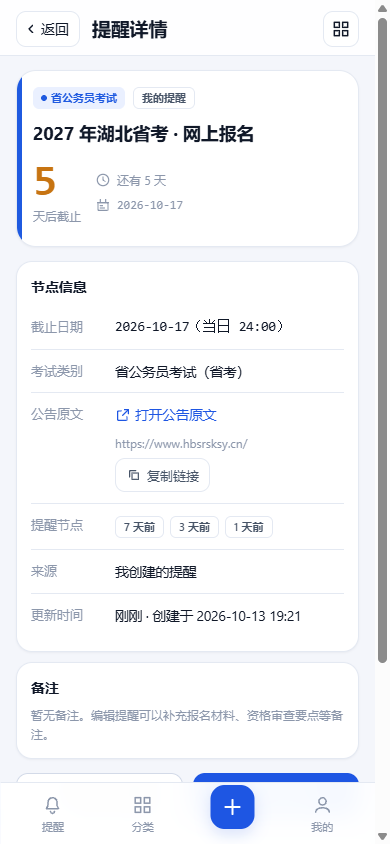
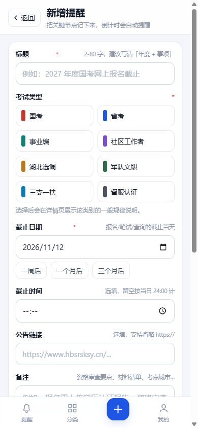
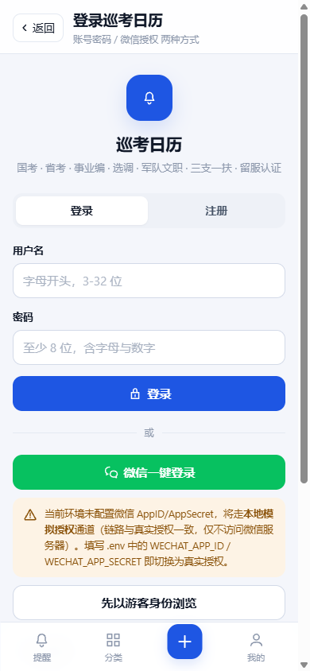
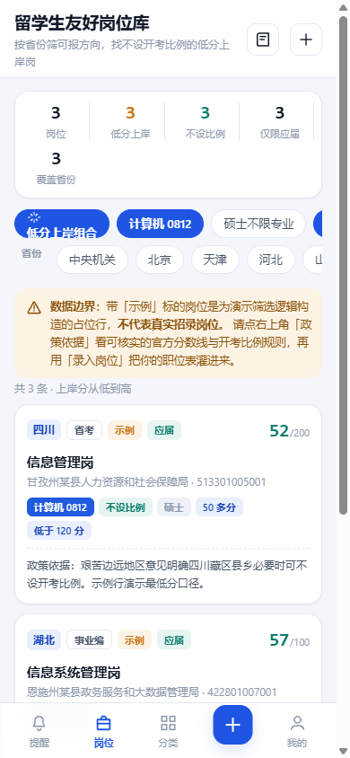
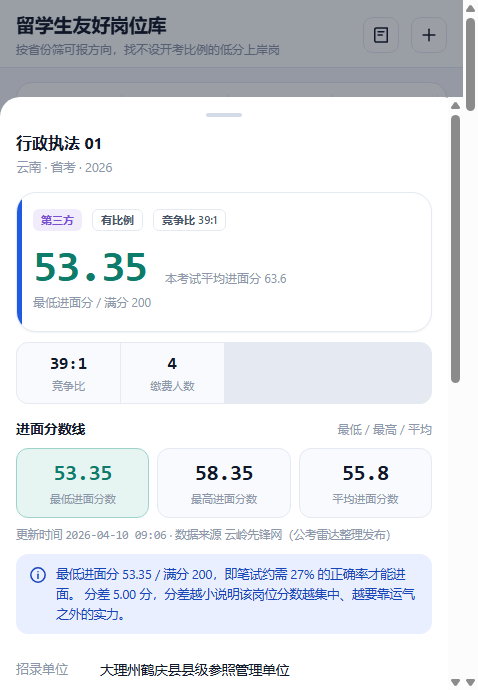
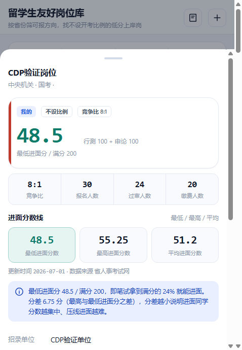
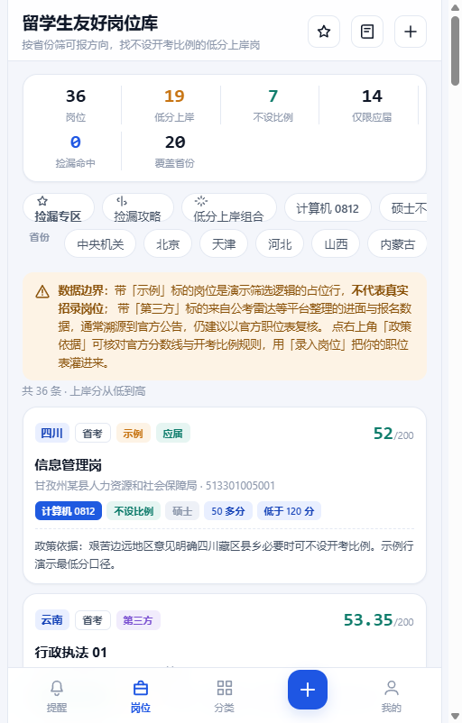
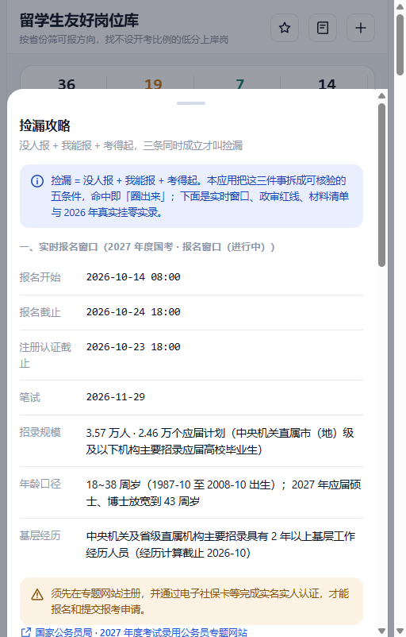
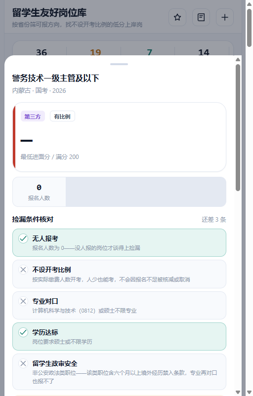

# 巡考日历 · 考编巡考生活

> 把散落在各省人事考试网、国家公务员局、军队人才网的招考节点，收进一个不刷屏、不遗漏的倒计时清单。
> 移动端优先的 Web App，**零外部运行时依赖**，`git clone` 后一条命令即可跑起来。

面向正在"考编巡考"的人：国考、省考、事业编、社区工作者、湖北选调、军队文职、三支一扶、留学生学历认证 —— 八条战线同时推进，最怕的是**报名截止日期悄悄错过**。

---

## 目录

- [界面预览](#界面预览)
- [功能一览](#功能一览)
- [快速开始](#快速开始)
- [工程记分卡](#工程记分卡)
- [技术设计](#技术设计)
- [接口一览](#接口一览)
- [配置项](#配置项)
- [CloudBase 云端部署](#cloudbase-云端部署)
- [测试与验收](#测试与验收)
- [目录结构](#目录结构)
- [已知边界](#已知边界)
- [许可](#许可)

---

## 界面预览

| 提醒首页 | 分类筛选 | 提醒详情 |
| :---: | :---: | :---: |
|  |  |  |

| 新增提醒 | 登录 | 我的 / 安全记录 |
| :---: | :---: | :---: |
|  |  |  |

| 岗位库列表 | 进面分数三件套 | 录入岗位（三件套 + 报名数据） |
| :---: | :---: | :---: |
|  |  |  |

| 捡漏专区（五条件圈选） | 捡漏攻略（窗口 / 政审 / 材料 / 实录） | 政法类职位 · 政审警告 |
| :---: | :---: | :---: |
|  |  |  |

> 全部界面使用统一的 24×24 SVG 线性图标，**刻意不使用任何 Emoji**，保证跨系统渲染一致、观感干净。

---

## 功能一览

### 1. 提醒首页
- 按**距离截止日由近及远**排序的倒计时卡片，一眼看到"最要紧的那个"。
- 每张卡片带考试类型标签 + 剩余天数；已过期、3 天内、7 天内分档着色，紧迫感分级。
- 顶部概览：进行中 / 7 天内 / 已过期 的数量统计。

### 2. 考试分类与筛选
- 八大类别，可按**类别多选 + 关键字 + 时间范围 + 归属（公共节点 / 我的）**组合筛选。
- 分类页显示每个类别的节点数量，以及"我创建的"数量（游客态下恒为 0，不会把公共节点误算成个人数据）。

### 3. 提醒详情页
- 截止时间、所属类别、**公告原文直达链接**、个人备注。
- 支持编辑、删除、**一键克隆**（明年同一场考试直接复制，改个日期就行）。

### 4. 新增 / 编辑提醒
- 标题、类型、截止日期、公告链接、备注五项表单，前端实时校验 + 后端二次校验。
- 公告截图可直接粘贴/选择上传，前端先用 Canvas 压缩再传，避免大图打爆带宽。

### 5. 登录（两种方式并存）
- **数据库账号登录**：用户名 + 密码，服务端 `scrypt` 加盐哈希落库，全程无明文。
- **微信授权登录**：OAuth2 / OIDC 标准授权码流程（未配置 AppID 时自动降级为**明确标注的 Mock 通道**，便于本地联调）。

### 6. 我的 / 安全记录
- 登录设备列表（设备名、IP、最后活跃时间、当前设备标记），可**远程吊销任意设备**。
- 安全审计日志：登录、注册、改密、退出、越权尝试等全部留痕，可按动作与结果筛选。
- 支持"退出当前设备"与"退出全部设备"。

### 7. 管理后台（首个注册用户自动成为管理员）
- 用户列表、角色调整（guest / user / admin）、账号启停。
- 全量审计日志查询，精确到"谁在什么时候对谁做了什么"。

### 8. 留学生友好岗位库
面向留学生考公的选岗工具，回答四个问题：**哪些省我能报、哪些方向我能报、哪里分数低好上岸、哪里能捡漏**。

- **筛选维度**：32 个省级区域（31 省 + 中央机关）× 专业通道（计算机科学与技术 0812 / 硕士不限专业 / 两者皆可）× 开考比例（不设比例 / 有比例）× 应届要求 × 分数段（50 多分 / 低于 120 分）× 省份多选 × 关键词，一键套用「低分上岸组合」。
- **进面分数三件套**：最低 / 最高 / 平均进面分数逐岗位呈现，卡片直接显示分数行，详情页给出「拿到满分百分之几就能进面」与分差解读。
- **报名数据**：竞争比、报名人数、过审人数、缴费人数，直接反映上岸难度；支持数据来源与更新日期留痕。
- **捡漏栏目**：把「没人报 + 我能报 + 考得起」拆成可核验的五条件——无人报考、不设开考比例、专业对口、学历达标、留学生政审安全，五条全中才「圈出来」（虚线徽标 + 卡片高亮）；「捡漏攻略」弹层提供 2027 国考实时报名窗口、每日盯数据方法、公安政法类职位对留学生的禁入条款、统考报名不需要简历的材料清单、2026 国考 89 个挂零职位的真实实录与「为什么捡不到」分析。
- **数据诚实四级**：`官方公告` / `第三方整理`（公考雷达等平台，通常溯源到官方公告）/ `示例数据`（演示筛选逻辑的占位行）/ `我录入的`，每级在界面有明确 badge 与说明，示例行不代表真实岗位。
- **政策依据页**：留学回国人员应届身份认定（国考口径）、2026 年度国考三档笔试合格线（90 / 95 / 105）、艰苦边远地区倾斜、分省开考比例（附官方公告链接）、留学生专业复核到 0812 的操作路径。
- **录入 / 批量导入**：官方职位表整理成 JSON 后一次性灌入（单次上限 200 条），或表单逐条录入（含「公安政法类职位」勾选，自动参与政审判定）；公共岗位游客可读，个人岗位仅本人与管理员可见。

---

## 快速开始

环境要求：**Node.js ≥ 20**（本机以 Node 22 验证）。**不需要 `npm install`** —— 运行时零依赖。

```bash
git clone <本仓库地址>
cd kaobian-xunkao-life

# 1) 可选：复制环境变量样例（不复制也能跑，全用默认值）
cp .env.example .env

# 2) 导入公共数据：21 条招考节点 + 36 条岗位库种子（幂等，重复执行不会重复插入）
npm run seed

# 3) 可选：顺带创建一个演示账号（密码随机生成且只打印一次）
npm run seed -- --demo-account

# 4) 启动
npm start        # 或 npm run dev（文件变更自动重启）
```

打开 <http://127.0.0.1:8787> 即可。**第一个注册的账号会自动成为管理员**，后续注册的都是普通用户。

```bash
npm test         # 全量测试套件（80 个用例）
npm run acceptance   # 验收门禁，产出 acceptance/acceptance-report.md
```

---

## 工程记分卡

| 指标 | 数值 | 说明 |
| --- | --- | --- |
| 运行时依赖 | **0** | 仅用 Node 内置模块；CloudBase SDK 为可选项 |
| 构建步骤 | **0** | 原生 ES Module SPA，浏览器直接加载，无打包器 |
| 源码规模 | **12,443 行 / 55 个文件** | 后端 5,984 行 · 前端 5,062 行 · 测试 1,397 行 |
| API 路由 | **42 个** | 覆盖鉴权 / 提醒 / 岗位 / 个人 / 上传 / 管理六组 |
| 测试用例 | **80 / 80 通过（100%）** | 鉴权 · 提醒 · 岗位库 · 权限边界 · 安全记录五套 |
| 验收项 | **12 / 12 通过** | 结论 **GATE PASS** |
| 预置招考节点 | **21 条 / 8 大类别** | 国考 5 · 军队文职 3 · 省考 3 · 其余各 2 |
| 预置岗位行 | **36 条** | 第三方整理 20（2026 国考挂零实录 11 + 事业编取消实录 4 + 公考雷达样本 5）· 示例 16（演示筛选逻辑） |
| 口令存储 | `scrypt` N=16384, r=8, p=1 | 加盐逐账号独立，库中无明文亦无明文比对 |
| 访问令牌时效 | 15 分钟 | HS256 签名，`timingSafeEqual` 恒时比对 |
| 刷新令牌时效 | 30 天 | 不透明随机串，服务端只存 sha256，**轮换 + 重放检测** |
| 权限模型 | 三级 RBAC | `guest` / `user` / `admin`，逐请求解析身份 |
| 界面 Emoji 数量 | **0** | 18 个前端文件全部通过无 Emoji 校验 |

---

## 技术设计

### 零依赖是怎么做到的

| 需求 | 常见做法 | 本项目的做法 |
| --- | --- | --- |
| HTTP 服务 | Express / Koa | `node:http` + 自研路由表 |
| 密码哈希 | bcrypt 原生模块 | `node:crypto` 的 `scrypt` |
| JWT | jsonwebtoken | 手写 HS256 签名 / 校验 |
| 数据存储 | SQLite / Mongo | 原子写 JSON 文件（`rename` 保证不半损） |
| 前端框架 | React + Vite | 原生 ES Module + 哈希路由 |
| 图标 | iconfont / 图片 | 内联 24×24 SVG 组件 |
| 测试框架 | Jest / Vitest | `node:assert` + 自研用例运行器 |

换来的是：**没有任何供应链风险，没有任何 install 等待，也不存在"依赖挂了就跑不起来"**。

### 双令牌与刷新轮换

```
登录  ──►  访问令牌 (15 min, JWT)  +  刷新令牌 (30 天, 不透明随机串)
                    │                          │
              每次请求携带              仅用于换取新令牌
                    │                          │
   过期 ────────────┘              服务端存 sha256，用后即换新的
                                             │
                                  旧令牌再被使用 ──► 判定为重放攻击
                                                     └─► 吊销整条令牌族
```

- 刷新令牌**永不落前端明文存储以外的位置**，服务端只保留哈希，库被拖走也无法直接复用。
- 每次刷新生成新的会话 ID，旧记录保留用于**重放检测**：旧令牌被再次使用即视为泄露，整族吊销。
- 区分"已轮换"与"被吊销"两种失效原因 —— 只有前者触发重放判定，避免正常换设备被误判为攻击。

### 权限边界

- 每个请求独立解析身份，`requireAuth` 与 `resolveIdentity` 分工明确：**公开接口返回匿名态而非抛 401**，避免"带着过期令牌访问公开页就被判未登录"的自锁死循环。
- 越权访问他人数据一律拦截，并且**拦截动作本身也写审计日志**——越权尝试要留痕。
- 管理员不能降低自己的角色（防把自己锁在门外）。

### 双存储驱动

```
业务代码 ──► db.users() / db.reminders() ...   （统一门面）
                    │
        ┌───────────┴───────────┐
   local 驱动              cloudbase 驱动
   本地 JSON 文件          腾讯云开发云数据库
   （默认，零配置）        （懒加载 SDK，同一套接口）
```

切换方式只是改一个环境变量 `DB_DRIVER`，业务代码**一行都不用动**。

---

## 接口一览

响应统一为 `ApiResponse{code, message, data}`，`code !== 0` 即为业务错误。
错误码按模块分段，便于排查：`1xxx` 鉴权 · `2xxx` 提醒 · `2010~2020` 岗位库 · `3xxx` 上传 · `4xxx` 权限 · `8xxx` 频控 · `9xxx` 系统。

<details>
<summary>展开全部 42 个路由</summary>

**鉴权**
| 方法 | 路径 | 说明 |
| --- | --- | --- |
| POST | `/api/auth/register` | 注册（首个用户自动成为管理员） |
| POST | `/api/auth/login` | 账号密码登录 |
| POST | `/api/auth/refresh` | 刷新令牌续期（轮换 + 重放检测） |
| POST | `/api/auth/logout` | 退出当前设备 |
| POST | `/api/auth/logout-all` | 退出全部设备 |
| GET | `/api/auth/session` | 读取当前会话（无令牌时返回匿名态） |
| GET | `/api/auth/wechat/url` | 获取微信授权链接 |
| GET | `/api/auth/wechat/callback` | 微信授权回调 |
| POST | `/api/auth/wechat/mock-authorize` | Mock 授权（仅未配置 AppID 时可用） |
| POST | `/api/auth/wechat/ticket` | 票据换取登录态 |

**提醒与目录**
| 方法 | 路径 | 说明 |
| --- | --- | --- |
| GET | `/api/catalog/categories` | 八大类别 + 数量统计 |
| GET | `/api/reminders` | 列表（支持筛选、分页） |
| POST | `/api/reminders` | 新建 |
| GET | `/api/reminders/:id` | 详情 |
| PATCH | `/api/reminders/:id` | 修改 |
| DELETE | `/api/reminders/:id` | 删除 |
| POST | `/api/reminders/:id/clone` | 克隆 |
| GET | `/api/reminders/stats/summary` | 倒计时概览统计 |

**岗位库（留学生友好）**
| 方法 | 路径 | 说明 |
| --- | --- | --- |
| GET | `/api/positions/catalogs` | 筛选目录：省份 / 专业通道 / 分数段 / 学历 / 数据级别 / 排序 |
| GET | `/api/positions/policies` | 政策基线：留学生应届认定 / 国考合格线 / 分省开考比例（附来源链接） |
| GET | `/api/positions` | 列表（省份多选、专业通道、开考比例、应届、分数段多选、分数上限、关键词、排序、捡漏五条件 `bargain=1`） |
| GET | `/api/positions/:id` | 详情 |
| POST | `/api/positions` | 录入岗位（登录用户） |
| PATCH | `/api/positions/:id` | 修改（本人或管理员） |
| DELETE | `/api/positions/:id` | 删除（本人或管理员） |
| POST | `/api/positions/import` | 批量导入（单次上限 200 条） |
| GET | `/api/positions/stats/summary` | 汇总统计（岗位页顶部卡片） |

**个人与安全**
| 方法 | 路径 | 说明 |
| --- | --- | --- |
| GET | `/api/me` | 个人资料 + 统计 + 存储信息 |
| GET | `/api/me/devices` | 登录设备列表 |
| DELETE | `/api/me/devices/:id` | 吊销某设备 |
| GET | `/api/me/audit-logs` | 本人审计日志 |
| GET | `/api/me/security-summary` | 安全总览与风险提示 |

**上传与管理**
| 方法 | 路径 | 说明 |
| --- | --- | --- |
| GET | `/api/uploads/config` | 上传限制配置 |
| POST | `/api/uploads` | 上传公告截图（本地落盘 / 云存储） |
| GET | `/api/admin/overview` | 后台概览 |
| GET | `/api/admin/users` | 用户列表 |
| PATCH | `/api/admin/users/:id/role` | 调整角色 |
| PATCH | `/api/admin/users/:id/status` | 启停账号 |
| GET | `/api/admin/audit-logs` | 全量审计日志 |

**系统**
| 方法 | 路径 | 说明 |
| --- | --- | --- |
| GET | `/api/health` | 健康检查（含存储驱动状态） |
| GET | `/api/meta` | 应用元信息 |
| GET | `/api/uploads/:file` | 读取上传文件 |

</details>

---

## 配置项

全部通过 `.env` 覆盖（见 `.env.example`），关键项：

| 变量 | 默认 | 说明 |
| --- | --- | --- |
| `PORT` | `8787` | 监听端口 |
| `DB_DRIVER` | `local` | `local` 本地 JSON / `cloudbase` 云数据库 |
| `DATA_DIR` | `./data` | 本地数据目录（已 gitignore） |
| `JWT_SECRET` | 开发自动生成 | 生产环境**必须**显式设置 |
| `ACCESS_TOKEN_TTL` | `900` | 访问令牌时效（秒） |
| `REFRESH_TOKEN_TTL` | `2592000` | 刷新令牌时效（秒，30 天） |
| `WECHAT_APP_ID` / `WECHAT_APP_SECRET` | 空 | 留空走 Mock 授权通道 |
| `CLOUDBASE_ENV_ID` 等 | 空 | `DB_DRIVER=cloudbase` 时必填 |
| `UPLOAD_MAX_BYTES` | `3145728` | 单文件上限（3 MB） |

⚠️ `.env`、`data/*.json`、`data/.jwt_secret`、上传文件均已在 `.gitignore` 中，不会被提交。

---

## CloudBase 云端部署

1. 在腾讯云开发控制台创建环境，拿到 `ENV_ID` 与密钥。
2. 创建六个集合：`users`、`reminders`、`positions`、`refresh_tokens`、`audit_logs`、`devices`（或通过 `CLOUDBASE_COLLECTION_PREFIX` 统一加前缀）。
3. 安装可选依赖并切换驱动：

```bash
npm install @cloudbase/node-sdk
# .env
DB_DRIVER=cloudbase
CLOUDBASE_ENV_ID=your-env-id
CLOUDBASE_SECRET_ID=your-secret-id
CLOUDBASE_SECRET_KEY=your-secret-key
JWT_SECRET=<一段足够长的随机串>
```

4. 重启即可。业务代码无需改动 —— 之所以能做到，是因为两种驱动实现的是**同一个接口契约**。

---

## 测试与验收

```bash
npm test              # 80 个用例
npm run acceptance    # 12 项门禁，写报告到 acceptance/acceptance-report.md
```

测试套件自带临时数据目录，**不会污染开发数据**，可反复执行。

| 套件 | 覆盖内容 |
| --- | --- |
| 鉴权 | 注册/登录/校验/口令策略/刷新轮换/重放检测/退出 |
| 提醒 | CRUD、克隆、筛选、分类统计、归属隔离、参数校验 |
| 岗位库 | 筛选器全组合、进面分数三件套、报名数据校验、录入/导入/权限、数据级别、捡漏五条件判定与政法类政审禁入 |
| 权限边界 | 游客只读、跨用户越权拦截、管理接口拦截、防自锁死 |
| 安全记录 | 设备列表、吊销生效、审计留痕、安全总览 |

验收门禁额外校验：前后端接口契约一致性、前端模块语法、静态资源可达、SPA 深链回退、目录穿越拦截、响应不回吐口令、Emoji 零使用、口令哈希落库形态。

**当前状态：测试 80/80、验收 12/12，结论 GATE PASS。**

---

## 目录结构

```
kaobian-xunkao-life/
├─ server/                  后端（零依赖）
│  ├─ index.mjs             HTTP 服务 + 路由装配 + SPA 回退
│  ├─ config.mjs            零依赖 .env 解析 + 密钥生成
│  ├─ catalog.mjs           八大考试类别定义
│  ├─ official-nodes.mjs    21 条公共招考节点（种子与测试共用）
│  ├─ position-catalog.mjs  岗位库目录：省份 / 专业通道 / 分数段 / 政策基线 / 捡漏五条件判定（附官方链接）
│  ├─ position-nodes.mjs    36 条岗位种子（第三方整理 20 + 示例 16）
│  ├─ seed.mjs              幂等种子导入
│  ├─ lib/                  错误码 / 口令 / JWT / 校验 / 频控 / ID
│  ├─ security/             会话签发 / 刷新轮换 / RBAC / 审计
│  ├─ providers/wechat.mjs  微信授权（真实 + Mock 双通道）
│  ├─ store/                local / cloudbase 双驱动 + 统一门面
│  └─ routes/               auth / reminders / positions / me / uploads / admin
├─ public/                  前端（原生 ESM，无构建）
│  ├─ index.html
│  ├─ css/app.css           设计系统（配色 / 间距 / 组件）
│  └─ js/
│     ├─ api.mjs            统一请求层（自动续期）
│     ├─ session.mjs        会话存储 + 跨标签同步
│     ├─ icons.mjs          24×24 SVG 图标集
│     └─ pages/             10 个页面模块
├─ tests/                   80 个用例（自研运行器）
├─ scripts/acceptance.mjs   验收门禁
├─ acceptance/              验收报告
└─ docs/screenshots/        界面截图
```

---

## 已知边界

坦诚说明，避免误解：

- **微信登录默认是 Mock 通道**。它是完整的 OAuth2 授权码流程实现，但未配置 `WECHAT_APP_ID` 时走模拟档案，界面会明确标注"模拟授权"。接入真实公众号/网站应用只需填配置，无需改代码。
- **`local` 驱动是单机文件存储**，适合个人使用与本地开发；多人并发写入场景请切到 `cloudbase`。
- **21 条公共节点是人工整理的样例数据集**，用于演示分类与倒计时；招考日期每年变动，请以**公告原文链接**为准，本项目不替代官方信息源。
- **岗位库种子分两类**：20 条「第三方整理」为真实数据——5 条公考雷达样本 + 11 条 2026 国考报名统计里的零报名职位实录 + 4 条事业编未达开考比例被取消实录（均带来源链接与统计时间，界面有 badge 与复核提示）；16 条「示例数据」是为演示筛选逻辑构造的占位行。**均不构成报考依据**；真实岗位请用「录入岗位」或批量导入从官方职位表灌入。
- **捡漏判定是筛子不是预言**：五条件基于岗位行内已录入的字段计算，报名数据随时间变化，2027 国考报名窗口内请每日回官方渠道复核；公安政法类职位对留学生的禁入判定依据公开文件，具体职位以公告备注为准。
- 岗位库的进面分数与报名数据由用户或第三方平台录入，本项目只做呈现与筛选，**不抓取、不推测、不补全**缺失字段。
- 上传功能默认限制单文件 3 MB，且本地驱动下文件落在 `data/uploads/`，生产环境建议接对象存储。
- 界面按**移动端优先**设计，桌面端可用但未做专门的宽屏布局优化。

---

## 许可

MIT License。招考信息以各官方发布渠道为准，本项目仅提供提醒与归档便利。
